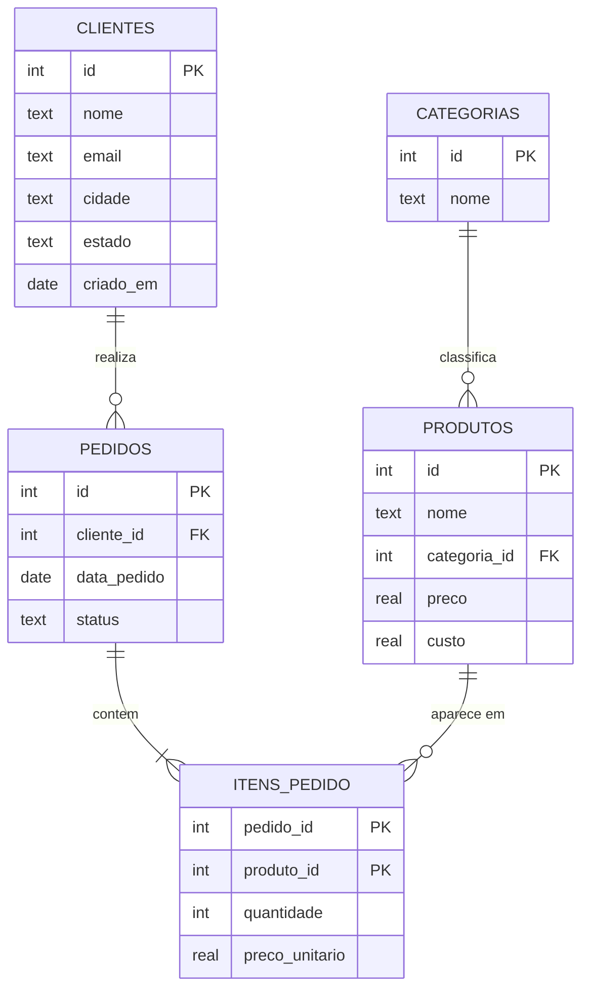

# 🛒 SQL Loja Analytics

[](https://github.com/thyagodev021/sql-loja-analytics/actions/workflows/ci.yml)


Projeto **100% em SQL** de análise de vendas de um e-commerce: modelagem, carga de dados gerada
por SQL, views, triggers e consultas analíticas de nível intermediário/avançado.
Roda em **SQLite**, sem servidor e sem dependências.

## ✨ O que tem aqui

| Tema | Onde | Técnicas |
|---|---|---|
| Modelagem | `sql/01_schema.sql` | PK/FK, `CHECK`, `UNIQUE`, índices |
| Carga de dados | `sql/02_seed.sql` | CTE recursiva, aritmética modular (dados determinísticos) |
| Views | `sql/03_views.sql` | `JOIN`, abstração de regras de negócio |
| Triggers | `sql/04_triggers.sql` | Regras de negócio no banco (`RAISE(ABORT)`) |
| Análises | `queries/` | Window functions (`LAG`, `NTILE`, `ROW_NUMBER`, `SUM OVER`), CTEs, agregação condicional |
| Testes | `tests/checks.sql` | Verificações de integridade (CI no GitHub Actions) |

## 🗺️ Modelo de dados



## 🚀 Como instalar e rodar

**1. Instale o SQLite** (CLI `sqlite3`, versão 3.25+ por causa das window functions):

- **Windows:** `winget install SQLite.SQLite` (ou baixe em <https://www.sqlite.org/download.html>, pacote *sqlite-tools*)
- **macOS:** já vem instalado; ou `brew install sqlite`
- **Linux (Debian/Ubuntu):** `sudo apt install sqlite3`

**2. Clone e crie o banco:**

```bash
git clone https://github.com/thyagodev021/sql-loja-analytics.git
cd sql-loja-analytics
sqlite3 loja.db < init.sql        # cria tabelas, dados, views e triggers
```

**3. Rode uma consulta:**

```bash
sqlite3 -header -column loja.db < queries/03_curva_abc.sql
```

Com `make` instalado: `make queries` roda todas as consultas e `make test` roda os testes.

## 📊 Exemplos de resultado

**Curva ABC de produtos** (`queries/03_curva_abc.sql`, primeiras linhas)

```text
produto                receita   pct_acumulado  classe
---------------------  --------  -------------  ------
Console Portátil       779610.0  39.4           A     
Tênis de Corrida       152061.0  47.1           A     
Jogo de Panelas        136461.0  54.0           A     
Perfume Importado      118460.5  60.0           A     
Jogo de Aventura       118452.6  65.9           A     
Cafeteira Elétrica     107593.2  71.4           A     
Mochila Urbana         85272.6   75.7           A     
Fone Bluetooth         78960.5   79.7           A     
Kit Halteres           75952.5   83.5           B     
```

**Segmentação RFM de clientes** (`queries/04_rfm_clientes.sql`)

```text
segmento               clientes  recencia_media_dias  pedidos_medios  receita_total
---------------------  --------  -------------------  --------------  -------------
1. Campeões            45        29.0                 19.5            774831.8     
2. Leais               36        90.0                 10.4            518725.7     
3. Potenciais          50        108.0                7.9             438656.1     
4. Novos / ocasionais  8         51.0                 5.9             46497.8      
5. Em risco            31        153.0                6.0             200318.1
```

**Margem por categoria** (`queries/06_margem_por_categoria.sql`)

```text
categoria    receita   lucro     margem_pct  pct_do_lucro_total
-----------  --------  --------  ----------  ------------------
Games        923794.8  231814.8  25.1        30.7              
Casa         251946.3  113451.3  45.0        15.0              
Esporte      235805.7  109630.7  46.5        14.5              
Beleza       180025.9  97035.9   53.9        12.8              
Eletrônicos  168354.7  77714.7   46.2        10.3              
Moda         128245.6  73125.6   57.0        9.7               
Livros       53986.0   29848.0   55.3        3.9               
Papelaria    36870.5   23038.5   62.5        3.0
```

## 📁 Estrutura

```
init.sql                     monta o banco inteiro
sql/                         schema, seed, views, triggers
queries/                     7 consultas analíticas comentadas
tests/checks.sql             verificações de integridade
.github/workflows/ci.yml     CI (GitHub Actions)
```

## 📄 Licença

MIT. Troque `SEU NOME` no arquivo `LICENSE`.
